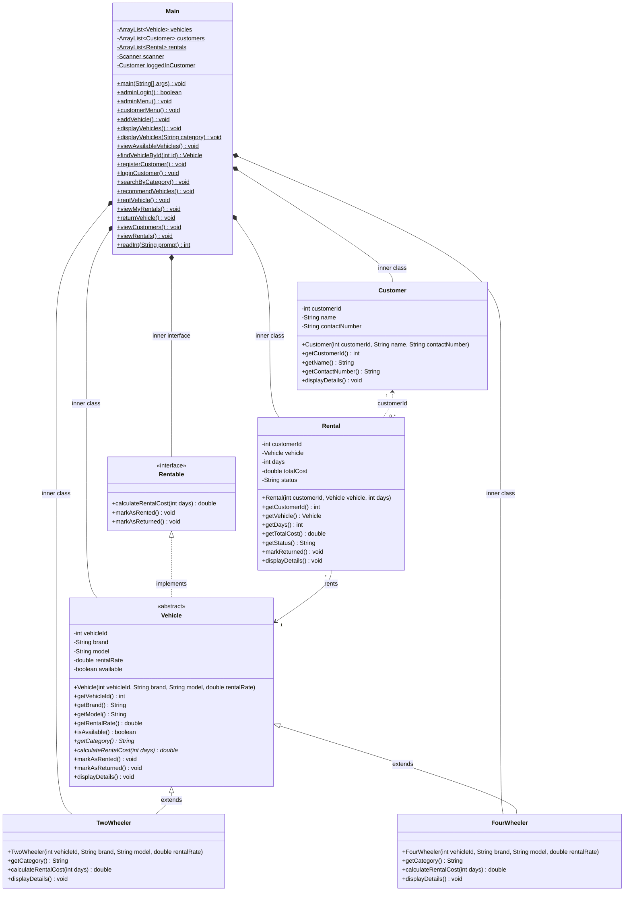

# FleetEase: Vehicle Rental Management System

FleetEase is a console-based Vehicle Rental Management System designed as an Object-Oriented Programming (OOP) academic project in Java. Built using a simplified single-file architecture, FleetEase demonstrates fundamental and advanced OOP concepts through a practical, real-world fleet and rental management use case.

---

## 📌 Features

### 1. Admin Dashboard
- **Admin Authentication**: Secured with predefined credentials (`admin` / `admin123`).
- **Add Vehicles**: Register new Two-Wheelers and Four-Wheelers with unique IDs, brand, model, and daily rental rate.
- **View All Vehicles**: Display full fleet catalog with status and category details.
- **View Available Vehicles**: Filter and inspect only vehicles ready for rent.
- **View Customers**: Monitor all registered customer accounts.
- **View Rental Records**: Full audit log of all active and completed rentals.

### 2. Customer Dashboard
- **Registration & Login**: Register with unique ID, name, and 10-digit contact number; password-free customer ID login.
- **Browse & Search**:
  - View all currently available vehicles.
  - Search vehicles by category (*Two-Wheeler* or *Four-Wheeler*).
- **Smart Vehicle Recommendation**: Enter a maximum daily budget and preferred vehicle category to find matching, available vehicles.
- **Rent a Vehicle**: Select vehicle, specify rental duration (days), review the calculated total cost, and confirm the booking.
- **View Personal Rentals**: Inspect your own active and returned rental history.
- **Return a Vehicle**: Settle and return rented vehicles, instantly restoring fleet availability.

---

## 🧬 OOP Concepts Demonstrated

| Concept | Implementation in FleetEase |
|---|---|
| **Classes & Objects** | Static inner classes `Vehicle`, `TwoWheeler`, `FourWheeler`, `Customer`, and `Rental` instantiated at runtime and managed in `ArrayList` collections. |
| **Encapsulation** | Private member variables across all models accessed and mutated through public getters and state methods (`markAsRented()`, `markAsReturned()`, `markReturned()`). |
| **Inheritance** | `TwoWheeler` and `FourWheeler` inherit common attributes and behaviors from the abstract class `Vehicle`. |
| **Abstraction** | `Vehicle` is declared `abstract` with abstract methods `getCategory()` and `calculateRentalCost(int days)`. |
| **Interfaces** | `Rentable` defines core contract methods (`calculateRentalCost`, `markAsRented`, `markAsReturned`) implemented by `Vehicle`. |
| **Compile-Time Polymorphism** | Method overloading with `displayVehicles()` and `displayVehicles(String category)`. |
| **Runtime Polymorphism** | Storing child objects in an `ArrayList<Vehicle>` and invoking overridden methods (`calculateRentalCost`, `displayDetails`, `getCategory`) resolved dynamically at runtime. |
| **Keywords** | Idiomatic use of `this`, `super`, and `@Override`. |
| **Exception Handling** | Built-in standard exceptions (`NumberFormatException`, `IllegalArgumentException`, `IllegalStateException`) thrown during validation and handled cleanly by menu loops without crashing. |

---

## 🏛️ Class Architecture



---

## 📁 Project Structure

```text
Vehicle-Rental-and-Fleet-Management-System/
├── .gitignore
├── Main.java     # Single-file architecture containing all classes & interface
└── README.md     # Documentation and guide
```

---

## 🚀 Getting Started

### Prerequisites
- Java Development Kit (JDK 8 or later).

### Compilation & Execution

1. **Clone or navigate to the repository directory**:
   ```bash
   cd "Vehicle-Rental-and-Fleet-Management-System"
   ```

2. **Compile**:
   ```bash
   javac Main.java
   ```

3. **Run**:
   ```bash
   java Main
   ```

---

## 🔑 Default Credentials

- **Admin Username**: `admin`
- **Admin Password**: `admin123`

---

## 🛡️ Input Validation & Error Handling

- **Unique & Positive IDs**: Vehicle and customer IDs must be positive integers and cannot conflict with existing records.
- **Phone Number Format**: Customer contact numbers must be exactly 10 digits (`\d{10}`).
- **Durations & Rates**: Rental rates and rental days must be strictly greater than 0.
- **Availability Guards**: Renting already booked vehicles or returning vehicles not rented by the customer are rejected gracefully with informative messages.
- **Non-numeric Safeguards**: `NumberFormatException` handling prevents program crashes when text is entered where a number is expected.

